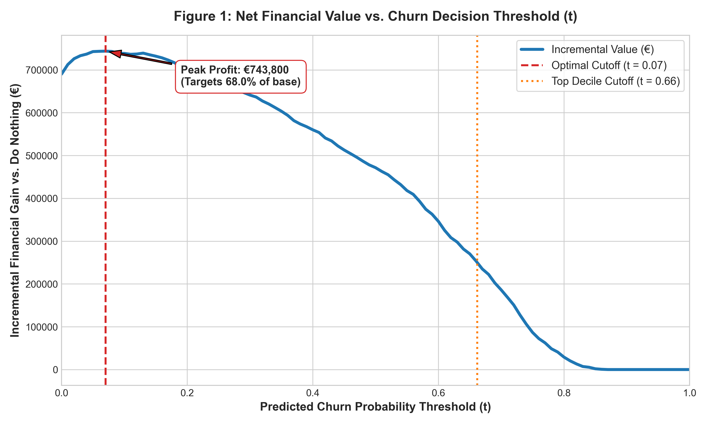
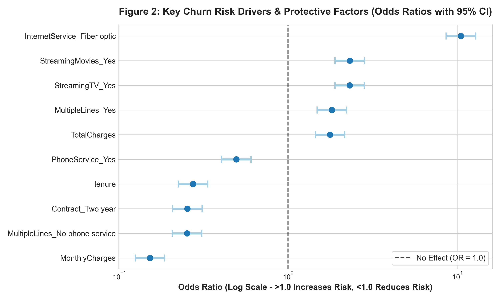

# Telco Customer Retention: Financial-First Churn Optimization

## 🎯 Executive Summary & Key Results

**Business Question:**  
How can Telco maximize net retention profits from a customer base while accounting for retention offer costs (€50), expected campaign acceptance rates (30%), and lost residual customer lifetime value (€500)?

**The Answer:**  
Deploying a regularized $L_2$ Logistic Regression pipeline at an **optimized decision threshold of $t = 0.07$** captures **€188,650.00 in net incremental profit** on an unseen holdout test set (1,409 customers) compared to an unmitigated churn baseline. Targeting all accounts with a predicted churn risk $\ge 7\%$ delivers an incremental gain of **€133.89 per customer**, demonstrating zero overfitting relative to training cross-validation performance.

| Metric / Dataset | Training CV (5,635 clients) | Holdout Test Set (1,409 clients) |
| :--- | :---: | :---: |
| **Optimal Threshold ($t$)** | **$0.07$** | **$0.07$ (Fixed)** |
| **Incremental Net Profit** | **€743,800.00** | **€188,650.00** |
| **Profit / Customer** | **€132.00 / client** | **€133.89 / client** |

---

## 📊 Core Visualizations

| Figure 1: Financial Threshold Optimization | Figure 2: Key Risk Drivers (Odds Ratios) |
| :---: | :---: |
|  |  |
| *Maximizing net gain at optimal threshold $t = 0.07$.* | *Fiber Optic drives risk; 2-year contracts shield accounts.* |

---

## 💶 Cost Matrix & Financial Framework

Misclassifications carry drastically different financial impacts in each direction:

| Prediction \ Reality | Customer Stays (No Churn) | Customer Leaves (Churn) |
| :--- | :--- | :--- |
| **Target / Offer (Predict Churn)** | **False Positive (FP)**<br>Cost: **-€50**<br>*(Wasted retention offer)* | **True Positive (TP)**<br>NET Gain: **+€100**<br>*(Successful retention)* |
| **Do Nothing (Predict No Churn)** | **True Negative (TN)**<br>Cost: **€0**<br>*(Status quo)* | **False Negative (FN)**<br>NET Loss: **-€500**<br>*(Lost customer value)* |

### Business Assumptions:
- **Residual Customer Lifetime Value (CLV):** €500
- **Retention Offer Cost:** €50
- **Offer Acceptance Rate:** 30%
- **Net Gain of True Positive (TP):** $0.30 \times (€500 - €50) - 0.70 \times €50 = \mathbf{+\text{€}100}$
- **Cost of False Positive (FP):** $\mathbf{-\text{€}50}$
- **Loss of False Negative (FN):** $\mathbf{-\text{€}500}$

$$\text{Net Incremental Value} = (\text{TP} \times €100) - (\text{FP} \times €50) - (\text{FN} \times €500) - \text{Value}(\text{Treat Nobody})$$

---

## 💡 Key Business Risk Drivers

1. **Fiber Optic Friction:** Fiber Optic subscribers exhibit **$>10\times$ higher churn odds** ($\text{OR} = 10.51$) than DSL users, highlighting price sensitivity and potential service friction in high-ARPU tiers.
2. **Contract Protection:** Two-year contracts reduce churn odds by **74.6%** ($\text{OR} = 0.254$), making long-term contract incentives the strongest retention lever.
3. **Tenure Stability:** Customer churn is heavily front-loaded; each standard deviation increase in tenure reduces churn risk by **72.6%** ($\text{OR} = 0.274$).

---

## 🛡️ Data Hygiene & Leakage Prevention

- **Unit of Analysis:** Individual customer identified by `customerID` (target: `Churn` $\in \{0, 1\}$).
- **Early Partitioning:** A holdout test set (20% of dataset, 1,409 accounts) was isolated immediately in Module 1 (`train_test_split`, `random_state=42`).
- **Zero Leakage:** The holdout set was stored separately in `data/test_set_holdout.csv` and excluded from exploratory analysis, imputation, scaling, and feature selection, reserved strictly for final validation.

---

## ⚠️ Limitations & Methodological Honesties

- **Risk vs. Incrementality (Uplift Gap):** Our model predicts *churn probability* $P(\text{Churn})$, not *treatment uplift*. We assume a uniform 30% acceptance rate across all risk levels. In practice, an Uplift Model is required to isolate "Incremental Responders" from "Do Not Disturbs."
- **Multicollinearity:** `TotalCharges` exhibits strong collinearity with `tenure` ($r = 0.83$, $\text{VIF} = 9.70$). Regularized $L_2$ regression stabilizes numerical estimates, but `tenure` remains the cleaner driver for executive reporting.
- **Sensitivity:** Policy hierarchy remains dominant across all tested offer costs (€25–€60) and acceptance rates (20%–40%).

---

## 🛠️ Repository Structure & Quickstart

```text
├── data/
│   ├── raw/                      # Raw dataset
│   ├── train_set.csv             # Partitioned training data (5,635 rows)
│   └── test_set_holdout.csv      # Isolated holdout evaluation data (1,409 rows)
├── notebooks/
│   ├── 01_setup_data.ipynb       # Framing & immediate stratification
│   ├── 02_baseline.ipynb         # Baseline modeling & CV pipeline
│   ├── 03_model.ipynb            # Regularization, boosting rejection, VIF
│   ├── 04_decision.ipynb         # Decision layer & holdout test evaluation
│   └── 05_plots.ipynb            # Standalone visual asset generation
├── reports/
│   ├── fig1_profit_vs_threshold.png
│   └── fig2_risk_drivers.png
├── requirements.txt              # Environment dependencies
└── README.md                     # Executive summary